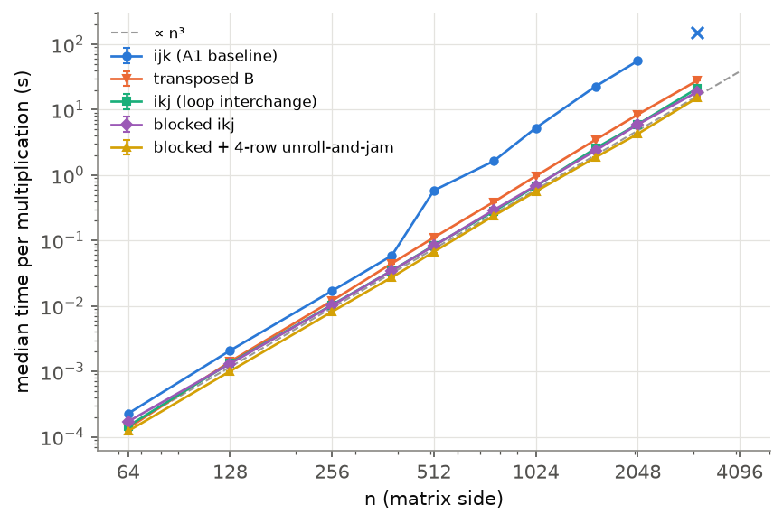
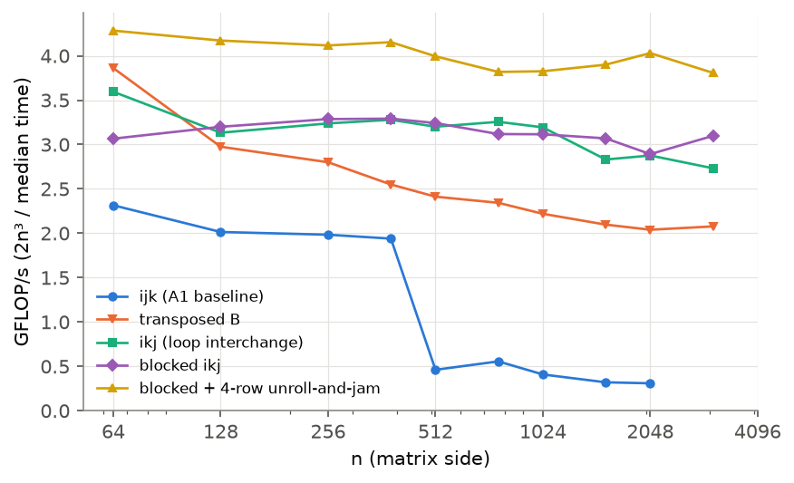
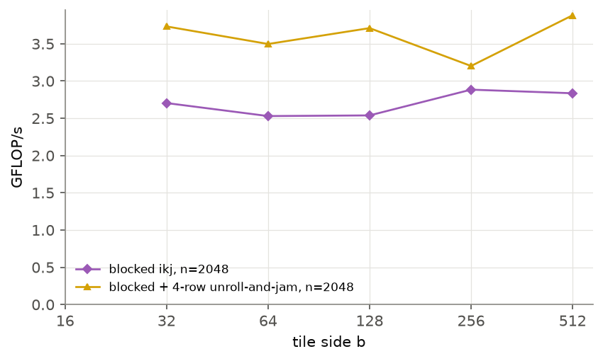
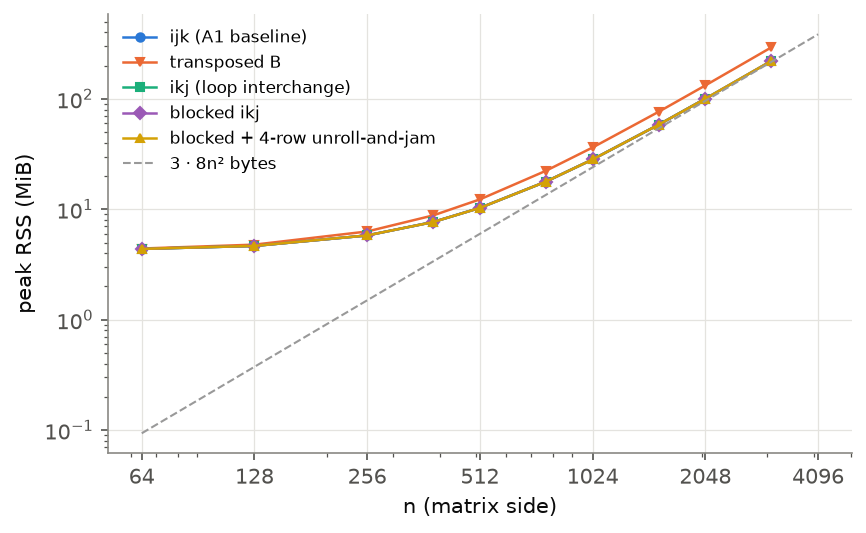
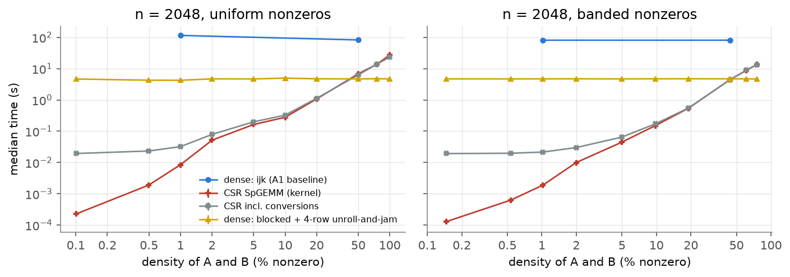
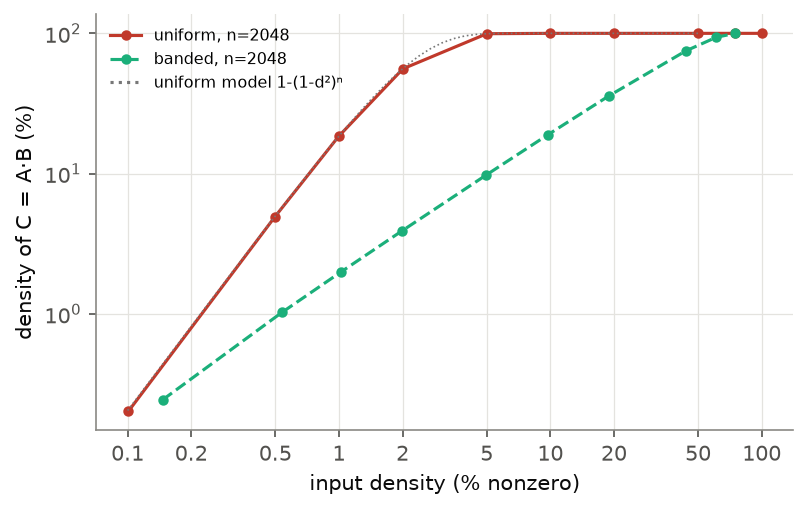
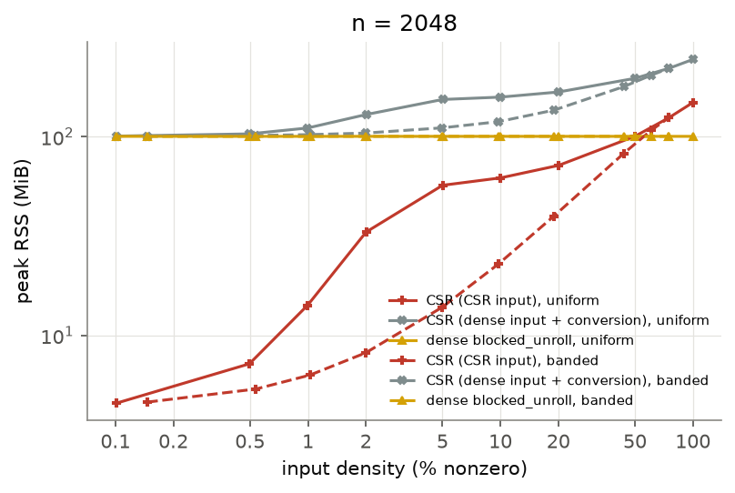
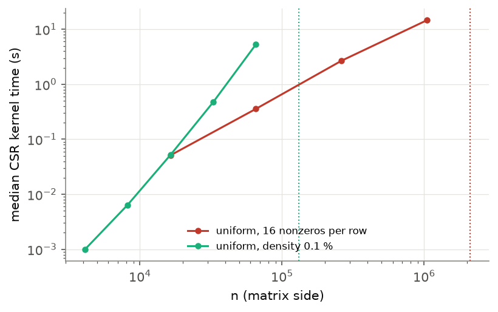

## Abstract

This study extends the C baseline of Assignment 1 (an i-j-k triple loop) with four sequential
optimisations and a sparse method. **Part A** compares the baseline with loop interchange (i-k-j),
transposition of B, cache blocking, and cache blocking plus 4-row unroll-and-jam, for
64 ≤ n ≤ 3072. **Part B** compares a CSR multiplication (Gustavson's algorithm, own code) with the
best dense method on the same logical matrices, for two nonzero distributions (uniform, banded)
and densities from 0.1 to 100 % at n = 2048, and runs CSR alone up to n = 2 097 152. All methods
were bit-for-bit identical to the baseline. On a Windows 11 laptop with an Intel Core i7-12700H
(gcc -O2, one thread, 5 measured repetitions per configuration), blocking with unroll-and-jam was
the fastest dense method at every size, 13.0× faster than the baseline at n = 2048 and steady at
3.8–4.3 GFLOP/s, while the baseline fell from about 2 to 0.3 GFLOP/s once n reached 512. CSR beat
the best dense method for every input up to 20 % (uniform) and 44 % (banded) density and lost
from 50 % and 61 % respectively; its cost followed the number of scalar products and the size of
the output, not the share of zeros. Dense-to-CSR conversion removed up to 99 % of its advantage at
very low density, and the fill-in of the product set the largest feasible sizes under a 4 GiB
budget. Conclusions are limited to these implementations, inputs and machine.

## 1. Introduction and objective

Assignment 1 showed that a textbook i-j-k triple loop in C becomes memory-bound for large *n*,
because its inner loop walks down a column of B. This study keeps that implementation as the
baseline and asks two separate questions:

* **Part A (dense optimisation).** How much do four sequential optimisations — loop
  interchange (i-k-j), transposition of B, cache blocking, and cache blocking combined with
  register blocking (unroll-and-jam) — change runtime and memory relative to the baseline, and
  how does the effect depend on *n*?
* **Part B (sparse storage).** For which tested densities and nonzero distributions does a
  multiplication in Compressed Sparse Row (CSR) format run faster or use less memory than the
  best dense method on the *same* logical matrices, and how much of the advantage is lost to
  format conversion and to the fill-in of the product?

**Hypotheses** (stated before measuring). H1: every method that reads B along rows will beat
the baseline by roughly an order of magnitude for n ≥ 1024, where the baseline is memory-bound,
and by much less for small *n*. H2: blocking will matter only once the data touched per row of
C exceeds the cache, so it may not help at all sizes. H3: the CSR kernel's work scales with
the number of scalar products, about d²n³ for uniformly random inputs of density d, so its
advantage should shrink quadratically with d and the break-even density should be high,
not the 5–10 % often quoted, but conversion costs and output fill-in will reduce it.

## 2. Background

**Memory hierarchy.** A cache line holds 64 bytes (8 doubles). An access pattern with unit
stride uses every element of each line; a stride of *n* doubles uses one element per line and
can also map many lines to the same cache set when *n* is a power of two [2], [3].

**Loop interchange.** The three loops of C = AB can be nested in any order without changing
the arithmetic. In i-k-j order the scalar aik is kept in a register while row *k* of
B and row *i* of C are streamed with unit stride [1], [3]. For one fixed (i, j) the products
are still added in increasing *k*, so the floating-point result is unchanged.

**Transposition.** Copying B into Bᵀ (O(n²) work) lets the i-j-k dot product read both
operands with unit stride while keeping the scalar accumulator.

**Cache blocking (tiling).** Splitting the loops into b × b tiles makes a tile of B
(8b² bytes) be reused from cache by b rows of A before it is evicted [4], [5]. The tile side
is a tuning parameter.

**Register blocking / unroll-and-jam.** Unrolling the *i* loop by four and fusing the copies
into the inner *j* loop makes each B element loaded from cache feed four multiply-adds into
four rows of C, cutting B loads by four and amortising loop overhead [4], [5].

**CSR and Gustavson's algorithm.** CSR stores, for each row, the column indices and values of
its nonzeros plus a row-pointer array: 12 bytes per nonzero (int32 index + float64 value) plus
8(n + 1) bytes. Gustavson's row-by-row algorithm [6] computes row *i* of C as the sum, over
the nonzeros aik of row *i* of A, of aik times row *k* of B, merging
them in a dense accumulator of length *n*. Its work is the number of scalar products,
Σi,k[aik ≠ 0]·nnz(Bk,:), which is ≈ d²n³ for independent
uniformly random positions. For such inputs the expected density of C is
1 − (1 − d²)n, which approaches 100 % once d²n ≫ 1 [7], [8].

## 3. Methodology

### 3.1 Implementations

All code is C11 written for this assignment, single-threaded, with no numerical library in
any timed region. `src/c/dense.c` contains five dense methods sharing the Assignment 1
interface, input format and output:

| Method | Change relative to the baseline | Extra memory |
|---|---|---|
| `ijk` | none: the Assignment 1 kernel, copied verbatim | — |
| `transpose` | Bᵀ is built inside the timed region, then i-j-k with unit-stride reads of A and Bᵀ | 8n² B |
| `ikj` | loop interchange; C zeroed inside the timed region | — |
| `blocked` | `ikj` restricted to b × b tiles of (i, k, j); b = 512 (Section 4.2) | — |
| `blocked_unroll` | `blocked` with the *i* loop unrolled by 4 and jammed into the *j* loop | — |

`src/c/sparse.c` implements CSR × CSR with Gustavson's algorithm: a symbolic pass computes the
exact number of nonzeros of each row of C with a marker array, C's index and value arrays are
allocated, and a numeric pass accumulates each row in a dense length-*n* accumulator. Columns
within a row of C are left in first-touch order. The A and B CSR inputs have sorted columns.
Workspace: one int64 marker and one double accumulator of length *n*. No library code is used;
SciPy only cross-checks nonzero counts during validation.

### 3.2 Inputs

**Part A** uses the Assignment 1 input generator: for each *n*, A and B are drawn from NumPy's
PCG64 generator seeded with [2026, n], uniform in [0, 1), float64, stored as shared
little-endian row-major files.

**Part B** generates pairs (A, B) with PCG64 seeded with [2026, n, round(10⁶d), dist], A first
and B next from the same stream. Values are uniform in (0, 1], so stored entries are never zero
and no cancellation can create zeros in C. Two nonzero distributions are used at the same
target density d (density = % of nonzero entries; sparsity = 100 % − density):

* **uniform**: every row receives k ~ Binomial(n, d) distinct columns drawn uniformly, so each
  entry is nonzero independently with probability d;
* **banded**: every entry with |i − j| ≤ w is nonzero, w = round((dn − 1)/2).

Size n = 2048; target densities 0.1, 0.5, 1, 2, 5, 10, 20, 50, 75 and 100 %. Each pair is saved
as CSR files and, for the dense methods, expanded to dense files of the Assignment 1 format, so
all methods multiply the same logical matrices. A separate scaling run uses the CSR method alone
on uniform inputs at sizes whose dense storage would exceed the memory budget (Section 4.6).

### 3.3 Correctness

`scripts/validate.py` checks every method on a known 2 × 2 product, identity and zero matrices,
random dense matrices with n ∈ {3, 50, 64, 100, 257} (sizes below the tile side and not
multiples of the tile side or of the unroll factor; tile sides 16, 64 and 256), and sparse cases
(sparse identity, zero, fully dense, uniform and banded at several densities, n ≤ 301; the CSR
program in both input modes). The reference is NumPy's `matmul` with rtol = atol = 10⁻¹²,
justified as in Assignment 1 by the forward error bound of a length-*n* dot product of values
in [0, 1] [9]. For sparse products the number of nonzeros is also compared with SciPy's.
**All 97 checks passed** on the measurement machine, the nonzero counts matched SciPy exactly,
and every method's output was **bit-for-bit identical to the Assignment 1 kernel**: all methods
add the products of each cij in increasing *k*, GCC does not reassociate (no
`-ffast-math`), and CSR only skips products that are exactly zero. During benchmarks each sample
prints the checksum of C; the checksums of all dense methods agree for every *n*.

### 3.4 Environment

One laptop: Intel Core i7-12700H (hybrid design, 6 performance + 8 efficiency cores, 20
threads; 11.5 MiB L2 in total, 24 MiB shared L3), 31.7 GiB RAM, Windows 11 Home (build 26300),
"High performance" power plan, on mains power. GCC 16.1.0 (MinGW-w64, MSYS2 build) with
`-O2 -std=c11` (no `-march`, no `-ffast-math`, the Assignment 1 flags); CPython 3.12.10 with
NumPy 2.5.4, SciPy 1.18.1 and Matplotlib 3.11.2 for input generation, validation and analysis.
GCC's vectorisation report (`-fopt-info-vec`) lists **no vectorised loop** in `dense.c` or
`sparse.c`, so every method runs scalar SSE2 code and the measured differences come from the
memory-access order, not from SIMD. All programs run one thread; the process was not pinned to a
core type. Full record: `results/environment.txt`. The baseline was **re-measured** on this
machine, so Assignment 1 timings are not mixed into any comparison.

### 3.5 Measurement protocol

The harness (`scripts/benchmark.py`, extended from Assignment 1; the whole study is run by
`scripts/run_all.py`) starts a fresh process per configuration: 2 warm-up samples, then 5
measured samples; every raw sample is kept. Dense kernels shorter than 2²⁵ multiply-adds are
batched (`max(1, round(2²⁵/n³))` products per sample) and reported per multiplication. Timer:
`QueryPerformanceCounter`.

* **Dense timed region**: the multiplication only. Inputs are loaded and C (and Bᵀ) allocated
  before timing; zeroing C (`ikj`, blocked methods) and building Bᵀ are inside.
* **Sparse timed region (kernel)**: symbolic pass, allocation of C's arrays, numeric pass.
  Freeing C is outside. In a second process for the same configuration the program reads the
  dense files and times **separately** the conversion of A and B to CSR (*convert-in*) and the
  expansion of C into a preallocated dense array (*convert-out*). "CSR total" = convert-in +
  kernel + convert-out, measured within the same sample of that second process. Timings with
  different boundaries are never compared without that label.

Reported statistics: median and interquartile range (IQR) of the 5 measured samples.
**Memory metric**: peak working set (`PeakWorkingSetSize` from `GetProcessMemoryInfo`), which
includes inputs, outputs, workspace and the C runtime (≈ 4.3 MiB); the sparse program also
reports the exact bytes of its CSR arrays. **Budgets** (declared before running): 150 s per
multiplication (sizes whose cubic extrapolation exceeds it are probed once with a 150 s hard
limit) and a 4 GiB memory limit per process (Windows Job Object). The tile side for the blocked
methods was chosen *before* Parts A and B as the side with the lowest median time of
`blocked_unroll` in a sweep at n = 2048 (Section 4.2). The baseline `ijk` was run in Part B on 4
of the 20 inputs only, because one configuration takes 7–13 minutes.

## 4. Results

All values are medians of 5 measured samples unless stated otherwise; the complete tables with
IQR, peak memory and every configuration are in `results/summary_*.md` and the raw samples in
`results/raw_*/`. Memory is given in MiB.

### 4.1 Part A: dense methods

Table 1 gives the median time, throughput (2n³ / time) and speed-up over the baseline for
selected sizes; Figures 1 and 2 show all ten sizes.

| n | `ijk` (s) | `transpose` (s) | `ikj` (s) | `blocked` (s) | `blocked_unroll` (s) | best speed-up vs `ijk` |
|---:|---:|---:|---:|---:|---:|---:|
| 128 | 0.00208 | 0.00141 | 0.00134 | 0.00131 | 0.00101 | 2.07 |
| 512 | 0.582 | 0.111 | 0.0839 | 0.0828 | 0.0672 | 8.66 |
| 1024 | 5.25 | 0.968 | 0.673 | 0.689 | 0.561 | 9.36 |
| 2048 | 55.6 | 8.42 | 5.97 | 5.94 | 4.26 | 13.0 |
| 3072 | > 150 (timeout) | 27.9 | 21.2 | 18.7 | 15.2 | ≥ 9.8 |
| GFLOP/s at 2048 | 0.31 | 2.04 | 2.88 | 2.89 | 4.03 | |
| GFLOP/s at 3072 | — | 2.08 | 2.73 | 3.10 | 3.81 | |

: **Table 1.** Median time per multiplication (s), 5 repetitions. IQR/median ≤ 5 % in 45 of the
49 completed configurations (largest: `blocked_unroll` at n = 512, 8.5 %; `ijk` at 1024, 6.6 %).
The baseline at n = 3072 was probed once because the cubic extrapolation from smaller sizes
predicted 188 s; it was stopped at the 150 s limit, so the speed-up there is a lower bound
(150 / 15.2).

Four patterns stand out. (i) Every optimised method beats the baseline at every size, but the
gap changes abruptly: it is 1.3–2.1× for n ≤ 384, where the baseline runs at 1.9–2.3 GFLOP/s,
and 4–13× from n = 512, where the baseline drops to 0.31–0.56 GFLOP/s. (ii) `transpose` loses
throughput steadily with *n* (3.86 GFLOP/s at n = 64, 2.04 at 2048), and `ikj` holds
3.1–3.6 GFLOP/s up to n = 1024 and then falls to 2.7–2.9. (iii) `blocked` is within 5 % of `ikj`
from n = 128 to 1024 (17 % slower at n = 64) — with b = 512 the matrix is one or two tiles wide there, so it is essentially
`ikj` — and becomes faster from n = 1536 (2.36 s against 2.56 s; 18.7 s against 21.2 s at 3072).
(iv) `blocked_unroll` is the fastest method at every size, with a nearly flat throughput of
3.8–4.3 GFLOP/s, and 1.23–1.40× faster than `blocked`.

### 4.2 Tile-side sweep

Figure 3 shows the throughput of the two blocked methods for tile sides 32 to 512 at n = 2048
(2 warm-up + 5 measured samples each). For `blocked_unroll` the best side was b = 512 (4.42 s,
3.88 GFLOP/s), followed by b = 32 (4.60 s) and b = 128 (4.63 s); b = 256 was the slowest (5.37 s).
For `blocked`, b = 256 (5.96 s) and b = 512 (6.06 s) were best. Following the rule fixed before
the sweep, b = 512 was used for every other experiment. The curve is not monotonic and the three
best sides of `blocked_unroll` differ by only 5 %, about the size of the difference between two
processes of the same configuration (4.42 s in the sweep against 4.26 s in Part A), so the
choice is not a sharp optimum. A 512 × 512 tile of B occupies 2 MiB, more than the 1.25 MiB L2 of
one performance core but well inside the 24 MiB L3.

### 4.3 Memory of the dense methods

Peak memory is identical for `ijk`, `ikj`, `blocked` and `blocked_unroll` at every size (for
example 100.3 MiB at n = 2048 and 220.3 MiB at n = 3072) and equals the storage of A, B and C
(3 · 8n² bytes, 96 MiB and 216 MiB) plus the ≈ 4.3 MiB runtime floor. `transpose` needs one
extra n × n array: 132.3 MiB at 2048 (+32 MiB = 8 · 2048² bytes) and 292.3 MiB at 3072
(Figure 4). None of the optimisations changes the asymptotic memory; only the transposition
adds 33 %.

### 4.4 Part B: sparse against dense on matched inputs

Table 2 summarises the comparison at n = 2048 (full table in `results/summary_sparse.md`). The
dense method is `blocked_unroll` on the same logical matrices expanded to dense files. Its time
did not depend much on the density: 4.24–4.97 s over all 20 inputs. The baseline `ijk`, measured
on four of them, took 79–116 s, independent of density as expected but clearly slower than the
55.6 s it took on the Part A inputs of the same size (Section 5, *Limitations*).

| Distribution | Density of A (actual) | nnz(C) | Density of C | Products / n³ | CSR kernel (s) | CSR incl. conversions (s) | Dense best (s) | Dense / CSR kernel | Dense / CSR total |
|---|---:|---:|---:|---:|---:|---:|---:|---:|---:|
| uniform | 0.10 % | 8 466 | 0.2 % | 9.9e-7 | 0.000227 | 0.0194 | 4.65 | 20 500 | 239 |
| uniform | 1.00 % | 773 309 | 18.4 % | 9.9e-5 | 0.00840 | 0.0320 | 4.24 | 505 | 133 |
| uniform | 5.01 % | 4 169 646 | 99.4 % | 0.0025 | 0.164 | 0.200 | 4.67 | 28.5 | 23.4 |
| uniform | 20.0 % | 4 194 304 | 100 % | 0.040 | 1.07 | 1.13 | 4.73 | 4.41 | 4.20 |
| uniform | 50.0 % | 4 194 304 | 100 % | 0.25 | 6.85 | 6.31 | 4.68 | 0.68 | 0.74 |
| uniform | 75.0 % | 4 194 304 | 100 % | 0.56 | 13.6 | 13.7 | 4.76 | 0.35 | 0.35 |
| uniform | 100 % | 4 194 304 | 100 % | 1.00 | 27.3 | 23.4 | 4.67 | 0.17 | 0.20 |
| banded | 1.02 % | 83 548 | 2.0 % | 1.1e-4 | 0.00189 | 0.0216 | 4.70 | 2 480 | 218 |
| banded | 4.97 % | 409 334 | 9.8 % | 0.0025 | 0.0442 | 0.0644 | 4.69 | 106 | 73 |
| banded | 19.0 % | 1 506 344 | 35.9 % | 0.037 | 0.537 | 0.547 | 4.73 | 8.8 | 8.7 |
| banded | 43.8 % | 3 146 752 | 75.0 % | 0.20 | 4.43 | 4.38 | 4.71 | 1.06 | 1.08 |
| banded | 61.0 % | 3 932 672 | 93.8 % | 0.39 | 8.79 | 8.90 | 4.69 | 0.53 | 0.53 |
| banded | 75.0 % | 4 194 304 | 100 % | 0.58 | 13.6 | 13.3 | 4.67 | 0.34 | 0.35 |

: **Table 2.** n = 2048, medians of 5 samples. "Products / n³" is the exact number of scalar
products of Gustavson's algorithm divided by the n³ multiply-adds of a dense product. "CSR incl.
conversions" adds dense→CSR conversion of A and B and CSR→dense expansion of C, measured in a
separate process; at high density it is sometimes *lower* than the kernel alone (6.31 s against
6.85 s at 50 %), which shows that the CSR kernel varied by up to ≈ 15 % between processes. For
banded inputs the requested densities 50, 75 and 100 % give actual densities 43.8, 61.0 and
75.0 % because the band is clipped at the matrix corners.

{width=100%}

**Where CSR helps.** The CSR kernel was faster than the best dense method for every input with
density ≤ 20 % (uniform) or ≤ 43.8 % (banded), by factors from 1.06 (banded, 43.8 %) and 4.4
(uniform, 20 %) up to 2.1 · 10⁴–3.7 · 10⁴ at 0.1–0.15 %. It was slower for every uniform input of
density ≥ 50 % (0.17–0.68×) and every banded input of density ≥ 61 % (0.34–0.53×). The crossover
therefore lies between 20 and 50 % for uniform inputs and between 44 and 61 % for banded inputs.

**What the crossover depends on.** Across all inputs the CSR time follows the number of scalar
products rather than the density. Near the crossover (products ≥ 0.2 n³), CSR spends
2.6–3.2 ns per product, while the dense kernel spends 0.49–0.58 ns per multiply-add, so CSR wins
only when it performs less than roughly one fifth of the dense work; for uniform inputs that is
d² < 0.2, i.e. d below about 45 %, consistent with the measured interval. At low density the cost
per product rises (7.6–27 ns for uniform inputs at 0.1–5 %, 2.1–7.0 ns for banded inputs)
because the fixed per-row work (n row pointers, resetting the length-*n* marker) and the
scattered writes of a large output dominate.

**Same density, different structure.** At equal input density the uniform and banded inputs
produce very different outputs (Figure 6). At 1 % density the uniform product is 18.4 % dense
while the banded one is 2.0 % dense; the uniform product is already 99.4 % dense at 5 % input
density, in agreement with 1 − (1 − d²)ⁿ. The CSR kernel took 4.4× longer for uniform than for
banded inputs at 1 % (8.40 ms against 1.89 ms) even though the number of products is nearly
identical (0.99 · 10⁻⁴ n³ against 1.05 · 10⁻⁴ n³): the uniform rows touch scattered columns and
write a 9.3× larger output.

**Conversion costs.** Converting both 2048 × 2048 dense inputs to CSR took 17–83 ms (it scans all
n² entries regardless of density) and expanding C took 2.5–14 ms. For sparse inputs this fixed
cost is 85–150 times the kernel time at 0.1 % density and cuts the advantage from ≈ 2 · 10⁴× to ≈ 240× at 0.1 %
density; from about 20 % density upwards it adds 6 % or less. The speed-ups of 10⁴ are only available when the data already
arrive in CSR form; when they arrive dense, CSR still wins by two orders of magnitude at low
density.

### 4.5 Memory of the sparse method

Figure 7 shows the peak memory at n = 2048. With CSR inputs the process needs 4.6 MiB at 0.1 %
density against 100.3 MiB for the dense method, but its memory grows with the *output*: at 5 %
uniform density C is already 99.4 % full and the process uses 56.9 MiB; at 50 % it equals the
dense method (100.4 MiB), and at 100 % it exceeds it (148.4 MiB), because a full CSR matrix costs
12 bytes per entry against 8. Banded inputs, whose products stay sparser, need less memory than
dense up to 43.8 % density (82.4 MiB) and more at 61 % (107.9 MiB). When the inputs arrive
dense, the dense copies are in memory as well and the CSR route is never smaller than the dense
one (100.6–244.4 MiB). For every CSR-input configuration, peak memory exceeds the exact CSR array
size by only 4.29–4.31 MiB, the runtime floor.

### 4.6 Limits: sizes beyond dense storage

Under the declared budgets the largest dense size tested was n = 3072 (15.2 s for
`blocked_unroll`); three dense float64 matrices exceed the 4 GiB limit beyond n ≈ 13 300, and at
the measured 3.8 GFLOP/s a dense product would exceed 150 s beyond n ≈ 6 600. The CSR method
alone was run on uniform inputs at larger sizes (Table 3, Figure 8).

| Series | n | nnz(A) | nnz(C) | CSR kernel (s) | Peak memory (MiB) | Dense storage 3·8n² (MiB) |
|---|---:|---:|---:|---:|---:|---:|
| density 0.1 % | 16 384 | 268 527 | 4.35 M | 0.0518 | 61 | 6 144 |
| density 0.1 % | 32 768 | 1.07 M | 34.7 M | 0.473 | 427 | 24 576 |
| density 0.1 % | 65 536 | 4.29 M | 272.5 M | 5.33 | 3 224 | 98 304 |
| density 0.1 % | 131 072 | — | — | memory failure | — | 393 216 |
| 16 nonzeros / row | 65 536 | 1.05 M | 16.7 M | 0.358 | 222 | 98 304 |
| 16 nonzeros / row | 262 144 | 4.19 M | 67.0 M | 2.68 | 877 | 1 572 864 |
| 16 nonzeros / row | 1 048 576 | 16.8 M | 268.4 M | 14.7 | 3 500 | 25 165 824 |
| 16 nonzeros / row | 2 097 152 | — | — | memory failure | — | 100 663 296 |

: **Table 3.** CSR kernel on large uniform inputs, 5 measured samples each (selected rows; full
table `results/summary_scale.md`). "Memory failure": the allocation of C's arrays after the
symbolic pass (8.44 GB at n = 131 072, 4.29 GB at n = 2 097 152) was refused under the 4 GiB
Job Object limit. Largest feasible sizes: n = 65 536 at 0.1 % and n = 1 048 576 at 16
nonzeros per row.

In both series the limit was the memory of the **output**, not of the inputs: at n = 131 072 the
inputs need about 400 MB but C would hold about 700 million nonzeros. Time grew faster than
the work: in the 16-nonzeros-per-row series the products grow linearly with *n* (about 16 × 16
per row), yet the time grew 41× for a 16× larger *n* (65 536 → 1 048 576), i.e. from about 21 to
55 ns per product (12 ns at n = 16 384). Once B (200 MiB at n = 10⁶) and the length-*n*
accumulator and marker (16 MiB) no longer fit in cache, each product becomes a random memory
access.

## 5. Discussion

**Part A.** H1 is confirmed for n ≥ 512 (4–13× speed-ups), and the small-*n* gains are smaller,
as predicted (1.3–2.1×). Because every method performs exactly the same floating-point
operations, in the same order for each cij, and GCC vectorised none of them, the
differences are attributable to the order of memory accesses and to the number of loads per
multiply-add. The baseline reads B down a column, touching a new 64-byte line for each
multiply-add. Up to n = 384 the column of B it walks (and much of B itself) still fits in the
private caches; from n = 512 (B = 2 MiB, above the 1.25 MiB L2 of a performance core) it drops
to 0.3–0.6 GFLOP/s, and the power-of-two strides at 512, 1024 and 2048 add cache-set conflicts,
as seen in Assignment 1. `ikj` and `transpose` read every operand with unit stride, but each still
streams the whole of B once per row of C; their gradual loss of throughput as B grows past the
L2 and towards the 24 MiB L3 (B is 32 MiB at n = 2048, 72 MiB at 3072) fits that picture. We did
not measure cache misses, so this attribution is an inference from the sizes at which the
changes occur.

H2 is confirmed in a specific form: blocking is not uniformly beneficial. While the data fit in
cache, plain blocking is no faster than `ikj`; once B exceeds the L3 it keeps the throughput
almost constant and wins by 12 % at n = 3072. The benefit is smaller than one would expect from a
deeper memory hierarchy, possibly because the 24 MiB L3 still holds a large part of B at the
tested sizes. Register blocking addresses a different bottleneck: in `ikj` each multiply-add
needs one load of B and one load and store of C; with four rows jammed, one load of B serves four
multiply-adds. That gave a further 1.23–1.40× at all sizes and made `blocked_unroll` the fastest
method everywhere. The tile-side sweep shows that, once register blocking is used, the result
changes by only about 5 % between b = 32, 128 and 512, so the choice b = 512 is not a fragile
tuning point. Optimisation effects (Part A) and storage effects (Part B) were measured
separately: all Part B dense times use the fixed `blocked_unroll` configuration.

**Part B.** H3 is supported: the crossover lies between 20 and 50 % density for uniform inputs
and between 44 and 61 % for banded inputs, far above what a "percentage of zeros" rule of thumb
suggests, because CSR's work shrinks with d². The data also show where the advantage is lost.
(1) *Indexing overhead*: each sparse product costs ≈ 3 ns against ≈ 0.5 ns for a dense
multiply-add, and much more at very low density or very large *n*. (2) *Conversion*: a
dense→CSR conversion is O(n²) and costs 85–150× the sparse kernel at 0.1 % density, so the
end-to-end speed-up falls from 10⁴ to 10². (3) *Output fill-in*: for uniform inputs the product
is essentially dense from 5 % density at n = 2048, which makes CSR's memory exceed the dense
method's from about 50 % input density and makes the output, not the inputs, the factor that
limits the largest feasible *n*. (4) *Structure*: at the same density, banded inputs give
outputs up to 9× sparser and a CSR kernel up to 4.4× faster than uniform inputs. The input
density alone therefore does not determine the outcome; the number of products, the output
density and the memory locality of the nonzeros do.

**Limitations.** One laptop, one compiler and one flag set (`-O2`, no `-march`): with SIMD
(AVX2 is available) the dense methods, and the crossover, would move. The i7-12700H mixes
performance and efficiency cores, and the process was not pinned, so the Windows scheduler may
have run some configurations on a slower core; together with laptop thermal behaviour this is
the most likely reason why the baseline took 79–116 s on the Part B inputs against 55.6 s in
Part A, and why the dense method varied between 4.24 and 4.97 s on inputs on which it does the
same work. These variations are much smaller than the effects reported, but they mean that
differences below about 15 % between separate processes should not be over-interpreted. The CSR
kernel leaves output columns unsorted; sorting would add cost. Two synthetic distributions do
not represent real sparse matrices (power-law rows, block structure). Part B used one size,
n = 2048, and the baseline was not run on every sparse input. The memory metric (peak working
set) includes inputs and runtime and is read once per process, so it does not separate the
kernel's own allocation. Cache behaviour was inferred, not measured with hardware counters.

## 6. Conclusions

Within the tested implementations, inputs and machine:

1. All five dense methods and the CSR method produce results bit-for-bit identical to the
   Assignment 1 kernel, so the measured differences are not numerical.
2. Changing only the order of memory accesses made the sequential dense product 4–13× faster
   than the baseline for n ≥ 512. Cache blocking combined with 4-row unroll-and-jam was the
   fastest method at every size (3.8–4.3 GFLOP/s, nearly flat up to n = 3072); plain blocking
   only paid off for n ≥ 1536, where loop interchange and transposition lost throughput. No
   optimisation changed memory use except the transposition (+8n² bytes).
3. CSR multiplication beat the best dense method for all tested inputs up to 20 % (uniform) and
   44 % (banded) density, and lost from 50 % and 61 % upwards respectively. Its cost follows the
   number of scalar products and the output size, not the percentage of zeros: conversion from
   dense storage removed up to 99 % of its advantage at very low density, uniform inputs filled
   the product almost completely from 5 % density, and the output size set the largest feasible
   sizes (n = 65 536 at 0.1 %, n = 1 048 576 at 16 nonzeros per row, under 4 GiB).

**Still unresolved:** hardware-counter evidence for the cache explanations, the effect of core
pinning and SIMD flags on both the dense methods and the crossover, sparse matrices from real
applications, and parallel versions of `blocked_unroll` and of the CSR kernel, which Assignment 3
will address.

## References

[1] G. H. Golub and C. F. Van Loan, *Matrix Computations*, 4th ed. Baltimore, MD, USA: Johns
Hopkins Univ. Press, 2013.

[2] U. Drepper, "What every programmer should know about memory," Red Hat, Inc., Tech. Rep.,
Nov. 2007. [Online]. Available: https://people.freebsd.org/~lstewart/articles/cpumemory.pdf

[3] J. L. Hennessy and D. A. Patterson, *Computer Architecture: A Quantitative Approach*, 6th
ed. Cambridge, MA, USA: Morgan Kaufmann, 2017.

[4] M. S. Lam, E. E. Rothberg, and M. E. Wolf, "The cache performance and optimizations of
blocked algorithms," in *Proc. 4th Int. Conf. Architectural Support for Programming Languages
and Operating Systems (ASPLOS)*, 1991, pp. 63–74.

[5] K. Goto and R. A. van de Geijn, "Anatomy of high-performance matrix multiplication," *ACM
Trans. Math. Softw.*, vol. 34, no. 3, pp. 12:1–12:25, May 2008.

[6] F. G. Gustavson, "Two fast algorithms for sparse matrices: Multiplication and permuted
transposition," *ACM Trans. Math. Softw.*, vol. 4, no. 3, pp. 250–269, Sep. 1978.

[7] Y. Saad, *Iterative Methods for Sparse Linear Systems*, 2nd ed. Philadelphia, PA, USA: SIAM,
2003.

[8] T. A. Davis, *Direct Methods for Sparse Linear Systems*. Philadelphia, PA, USA: SIAM, 2006.

[9] N. J. Higham, *Accuracy and Stability of Numerical Algorithms*, 2nd ed. Philadelphia, PA,
USA: SIAM, 2002.

## Reproducibility materials

All code, raw data and scripts are in the accompanying GitHub repository
(<https://github.com/DiegoRuiz16/BD-Individual_addignment_2>) and in
`Assignment02_RuizRodriguez_Materials.zip`. On Windows 10/11 with MinGW-w64 GCC and Python 3.12
(`pip install numpy scipy matplotlib`), from a folder outside OneDrive:
`python scripts\run_all.py --check` (build and correctness tests) and `python scripts\run_all.py`
(the whole study: build, validation, environment record, tile sweep, Parts A and B, scaling run,
tables and figures; 110 minutes on the machine of Section 3.4). Raw samples:
`results/raw_blocks/`, `raw_dense/`, `raw_sparse/`, `raw_scale/`; console logs
`results/benchmark_*_log.txt`; chosen tile `results/chosen_tile.txt`. All inputs are regenerated
deterministically from the seeds in Section 3.2.

## Use of generative AI

In line with the course policy: an AI assistant (Claude, Anthropic) was used to help write the
implementations, the benchmarking and analysis scripts, and the text of this report. The
measurements reported here are the actual outputs of those scripts on the author's computer,
kept unmodified in `results/raw_*/`. The author has reviewed the code and the results and is
responsible for the content and conclusions.
